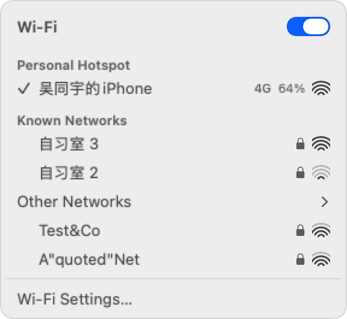

# NetBar

菜单栏里的 Wi-Fi 列表。



## 功能

点菜单栏图标弹出网络列表。已连接的网络带勾选标记,个人热点单独成组。

连接 iPhone 个人热点时,菜单栏图标换成手机,行尾显示信号格、蜂窝网络和手机电量。

已保存的网络排在前,信号强的优先;其余折叠在 **Other Networks** 下,点一下展开。底部 **Wi-Fi Settings…** 打开系统 Wi-Fi 设置。

## 安装

从 [Releases](../../releases) 下载 `NetBar.zip`,解压后将 `NetBar.app` 拖入「应用程序」。

## 构建

```sh
make build      # 编译引擎与 App
make test       # 引擎与 App 单元测试
make run        # 构建并启动
make snapshot   # 把菜单渲染成 build/menu.png
make project    # 改动源文件清单后重新生成 Xcode 工程
```

## 发布

推送 tag 才会触发 CI,平时提交不占用额度。

```sh
git tag v1.0.0
git push origin v1.0.0
```

CI 会跑完测试后打包 `NetBar.zip` 并创建 Release。
